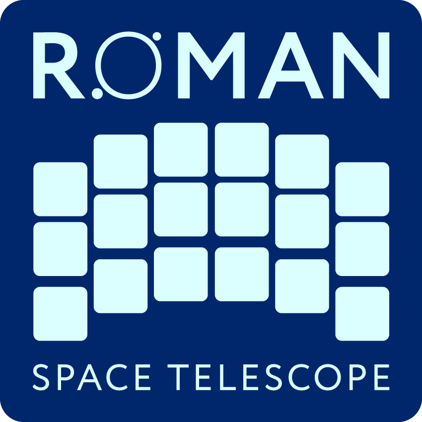

.. image:: _static/stsci_pri_combo_mark_horizonal_white_bkgd.png
   :width: 83%
   :target: https://stsci.edu

.. romancal documentation master file
   You can adapt this file completely to your liking, but it should at least
   contain the root `toctree` directive.

:ref:`genindex`  |  :ref:`modindex`

===========
User Manual
===========

.. toctree::
   :maxdepth: 2

   roman_datamodels/datamodels/introduction.rst
   roman_datamodels/datamodels/general_structure.rst
   roman_datamodels/datamodels/using_datamodels.rst
   roman_datamodels/datamodels/creating_datamodels.rst
   roman_datamodels/datamodels/stnode.rst
   roman_datamodels/datamodels/index.rst

=====================
Package Documentation
=====================

.. toctree::
   :maxdepth: 1

   roman_datamodels/package_index.rst
   roman_datamodels/changes.rst
